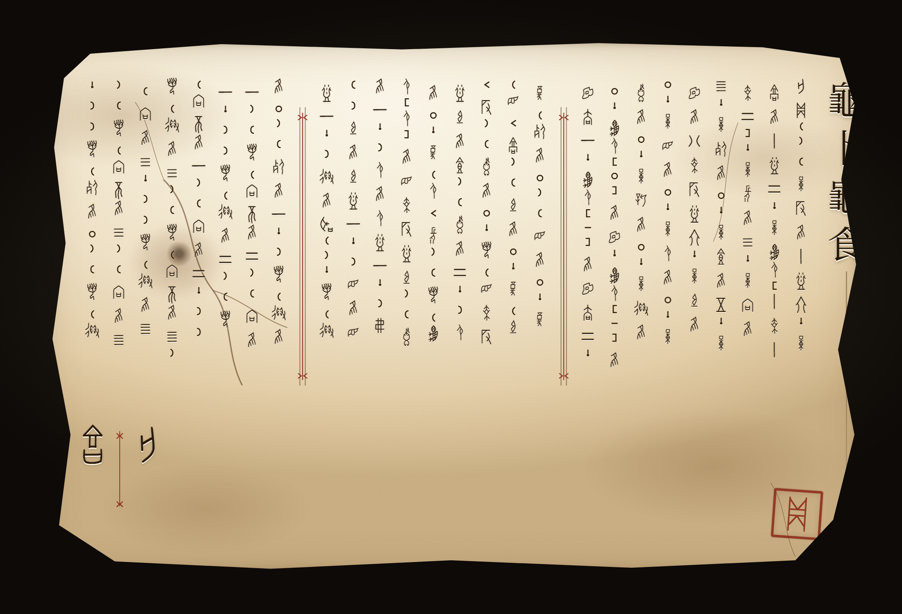
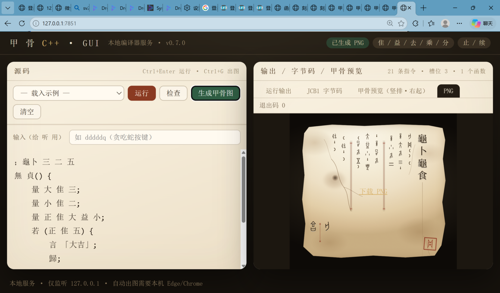

# 甲骨 C++（jiagu-cpp）

用**甲骨字形**写成的一门小语言，配一套自写的编译器：词法 → 语法树 → 语义检查 →
自研字节码 **JCB1** → 内置虚拟机执行。不依赖 g++ 或任何外部编译器。

编译器还能把程序**自动刻成甲骨文竖排对刻图（PNG）**：竖排、自右向左、
`若/弗` 成对刻、左下 `吉｜亡` 占辞、右下朱印 `貞`。



> 上图为 `jcp png snake-bone.jcp` 自动生成：程序代码被转写成甲骨铭文。

## 特性

- **甲骨关键字**：`量`(int) `無`(void) `歸`(return) `若/弗`(if/else) `復/從`(while/for)
  `止`(break) `续`(continue) `言`(print) `卜`(assert) `吉`(1) `貞`(入口 main)
- **甲骨算子**（避开重文号/刻划歧义）：
  `隹` 赋值/相等、`益` 加、`去` 减、`乘` 乘、`分` 除、`不隹` 不等、
  `且/或` 逻辑与/或；旧写法 `= + - * / == != && ||` 仍兼容
- **多位数**：`十六`、`二十`、`一百零五` 连续数字字自动合成
- **数组**：`量 名[长度];`，`名[下标]` 读写，运行时越界检查
- **内建**：`屏()` 清屏、`书(值)` 原样输出、`听()` 读键（WASD/方向键）、`歇(毫秒)`
- **自研字节码 JCB1 + 异步虚拟机**，含越界/除零/递归深度/指令数等运行时保护
- **现代 CLI**：`run / check / build / png / repl / examples / version / help`，
  编译错误显示「行/列 + 源码行 + ^ 光标」
- **自动程序图**：`jcp png 源.jcp [-o 输出.png] [--title …]`，支持 `--png` 边跑边出图
- **竖排对刻源**：`.jcpv`（每列一行代码、字自上而下、列自右向左）

## 快速开始

```bash
node jcp.mjs san.jcp            # 编译并运行「三加二」→ 大吉
node jcp.mjs snake.jcp          # 玩贪吃蛇（方向键/WASD，q 退出）
node jcp.mjs png snake.jcp -o snake.png   # 自动生成甲骨程序图
node jcp.mjs repl               # 一体机：写代码 / :run / :png / :vertical
node jcp.mjs gui                # 图形界面：编辑器 / 运行 / 字节码 / 甲骨预览 / 出图
node tests.mjs                  # 31 项自动测试
```

## 示例：三加二

```
；龜卜 三 二 五
無 貞() {
    量 大 隹 三;
    量 小 隹 二;
    量 正 隹 大 益 小;
    若 (正 隹 五) {
        言 「大吉」;
        歸;
    }
    言 「無吉」;
    歸;
}
```

## CLI

```
jcp run   源.jcp      编译并运行
jcp check 源.jcp      只检查（词法/语法/语义/字节码）
jcp build 源.jcp      只生成 JCB1 字节码
jcp png   源.jcp      自动生成甲骨程序 PNG
jcp repl              编译器的编写·编译·运行一体机
jcp examples          列出示例
jcp version / help
```

选项：`--quiet --brief --emit --save out.jcb --vertical --to-vertical`
`--png`（编译/运行同时出图）、`-o`、`--title`。


## 图形界面（GUI）

```bash
node jcp.mjs gui                 # 默认 http://127.0.0.1:7801，自动开浏览器
node jcp.mjs gui --port 7801 --no-open
```

左右双栏：左侧源码（示例下拉、运行、检查、生成甲骨图），右侧运行输出 / JCB1 字节码 /
甲骨预览（竖排·自右向左）/ PNG 预览与下载；`Ctrl+Enter` 运行、`Ctrl+G` 出图；
输入框给 `听()` 提供按键。桌面版单文件 exe 内置字体，`jcp.exe gui` 直接可用。


## 语言速查

| 甲骨 | 含义 | 甲骨 | 含义 |
|---|---|---|---|
| 量 | int | 無 | void |
| 歸 | return | 若/弗 | if/else |
| 復/從 | while/for | 止/续 | break/continue |
| 言 | 输出 | 卜 | 占断断言 |
| 吉 | 1 | 貞 | 入口函数 |
| 隹 | = / == | 不隹 | != |
| 益/去/乘/分 | + - * / | 且/或 | && \|\| |

数字：`一…十`，也接受 `0-9` 与多位数 `十六/二十/一百零五`；
字符串 `「…」`；注释 `；` 开头。

## 目录

```
jcp.mjs        编译器（词法/语法/语义/字节码/虚拟机/PNG 生成）
tests.mjs      31 项自动测试
SPEC.md        语言规范（v0.6.1）
*.jcp *.jcpv   示例与测试程序
docs/          自动生成的示例图
```


## 模块、常量与标准库（v0.8.0）

```
引 學;                  ；模块：加载 lib/學.jcp（exe 内置标准库兜底）
恒 甲 隹 七;            ；常量：不可赋值

無 貞() {
    言 大(三, 五);      ；标准库函数
    言 兆(七, 十, 二十); ；确定式随机 [十, 二十)
    歸;
}
```

- 标准库模块：`lib/學.jcp`（大 小 方 正 余）、`lib/兆.jcp`（兆(種,上,下)，内部 `引 學;`）
- 模块可嵌套引用，自动去重；模块不能定义入口 `貞`
- GUI：编辑器带**行号与语法高亮**，新增「保存 PNG 到桌面」，`jcp gui` 默认应用窗口打开

## 类型系统（v0.9.0）

| 甲骨 | 类型 | 说明 |
|---|---|---|
| 量 | int | 整数 |
| 分 | float | 浮点（`三·一四` / `3.14`） |
| 字 | string | 字符串（`「…」`，`益` 拼接） |
| 占 | bool | 布尔（`對` / `非`，比较结果） |

```
分 甲 隹 三·一四;
字 名 隹 「甲骨」 益 「C++」;
占 吉否 隹 對;
分 浮陣[十];  字 文陣[十];  占 兆陣[十];
若 (甲 > 三 且 吉否) { 言 名; }
```

- 比较运算产生 `占`；`若/復/從` 条件必须是 `占`；`量` 可隐式提升为 `分`
- 类型化数组按元素类型检查；`卜` 接受 `占` 或 `量`
## 打包单文件 exe（可选）

```bash
node build-sea.mjs                 # 生成 bundle.cjs / sea-config.json
node --experimental-sea-config sea-config.json
cp "$(which node)" jcp.exe          # Windows: copy node.exe
npx postject jcp.exe NODE_SEA_BLOB sea-prep.blob \
  --sentinel-fuse NODE_SEA_FUSE_fce680ab2cc467b6e072b8b5df1996b2
```

> exe 内置甲骨字体与字形表；自动出图需要本机有 Edge/Chrome（可用 `JCP_BROWSER` 指定）。

## 许可

MIT License，见 [LICENSE](LICENSE)。

---

**English brief**: *jiagu-cpp* is a tiny programming language written with oracle-bone
script glyphs, with its own compiler, bytecode (JCB1) and async VM. It can run games like
Snake, and can automatically render a program as a vertical oracle-bone inscription PNG.
MIT licensed.
